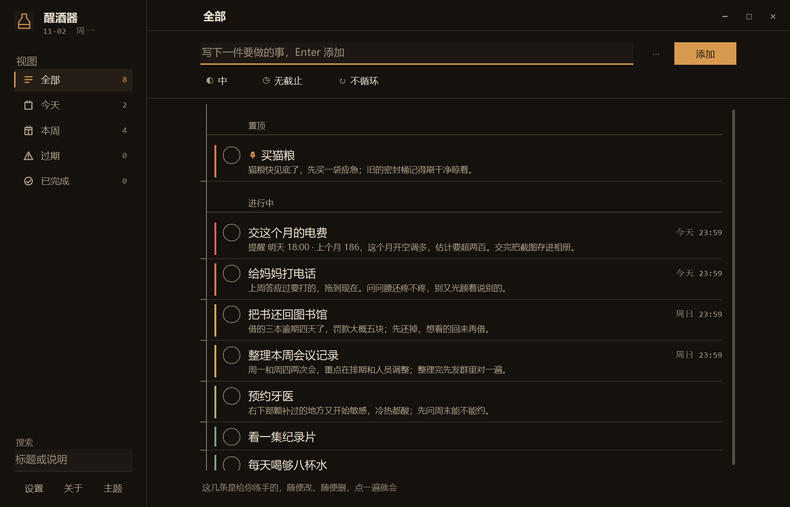
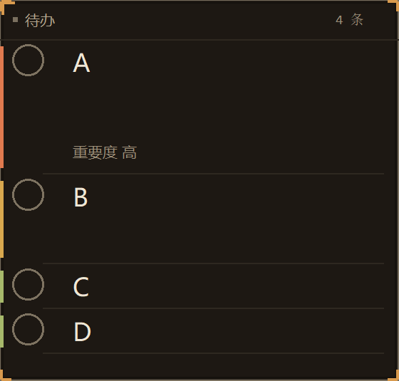

# 醒酒器 Decanter

> 把待办写清楚，今天少一点挂心的事。

醒酒器是一个 Windows 本地待办工具：单文件、无账号、不联网，数据放在自己的文件夹里。界面是自绘的账本风格，主界面 + 一个可以随时展开/收起的悬浮窗，适合放在屏幕角落随时看一眼。

> 当前仓库是 v0.11 收口版源码，目标是整理成可发布的 v1.0。正式发布以 Releases 中的便携包为准。



## 目录

- [功能](#功能)
- [快速开始](#快速开始)
- [界面与操作](#界面与操作)
- [目录结构](#目录结构)
- [架构说明](#架构说明)
- [数据与隐私](#数据与隐私)
- [构建与测试](#构建与测试)
- [设计取舍](#设计取舍)
- [已知限制](#已知限制)
- [路线图](#路线图)
- [许可证](#许可证)

## 功能

### 主界面

- **五区账本**：左索引轨（品牌/视图/搜索/设置）+ 右账本页（页眉/书写区/分组列表/动作栏）。
- **待办**：标题、备注、重要度（高/中/低）、截止时间、提醒、循环、置顶。
- **视图**：全部、今天、本周、过期、已完成。
- **编辑**：选中行后编辑，或双击行；改标题/备注/字段后保存。
- **完成/恢复**：点行首圆圈完成，在“已完成”里再点圆圈恢复。
- **删除**：选中后点删除，弹出确认框，确认后才删除。
- **搜索**：左轨搜索框按标题/说明过滤。
- **窗口**：小屏（960×620）与全屏两态；不提供自由拖边缩放，保证任何状态下界面可用。
- **主题/字号**：四套主题（暖纸/暖黑/暖账本/石墨）+ 字号三档，重启后保留。

### 悬浮窗

- 启动时默认只显示右下角悬浮窗，主界面藏在托盘；点悬浮窗左上角 **瓶子图标 / “醒酒器”** 打开主界面。
- 紧凑态 3 行内容预算；置顶区按 3/2/1 行自然显示，默认区每条 1 行。
- 展开态显示全部待办，高度随条目数量自适应，条目多时允许超出屏幕（靠收起回来）。
- 收起动画采用两段式：先像车窗一样掠过不保留的条目，再让保留的置顶条目同步从 3 行压到 1 行；最后一条的下框与窗口下框同步。
- 悬浮窗关闭只隐藏，不退出应用；退出走托盘菜单。




### 设置与数据

- 设置页：主题、字号、成长/提醒等偏好；高级项集中放置。
- 数据默认在程序目录 `data\todos.db`；换电脑/备份只需复制 `data` 文件夹。
- 支持导出/导入 `.decanter` / JSON（见设置或底部动作）。
- 正常使用不联网；没有账号、云同步、遥测。

## 快速开始

### 使用发布便携包

1. 下载 `Decanter-v1.0-portable.zip`。
2. 解压到任意可写目录。
3. 双击 `Start-Main.cmd` 直接进主界面；或双击 `Decanter.exe` 先看悬浮窗。
4. 备份就是复制 `data\`；升级只需替换 exe/dll，保留 `data\`。

### 从源码构建

要求：Windows 10/11 x64，系统自带 .NET Framework 4.8（Windows 10/11 自带；无需安装 Visual Studio）。

```powershell
git clone <repo-url>
cd decanter
powershell -ExecutionPolicy Bypass -File .\build.ps1
.\run\Decanter.exe --ui=main
```

或使用：

```powershell
.\run.ps1
```

`build.ps1` 使用 Windows 自带的 `csc.exe` 编译，输出到 `run\`，并自动复制 `lib\sqlite3.dll` 与配置文件。

## 界面与操作

| 操作 | 方式 |
|---|---|
| 添加 | 顶部输入标题，Enter |
| 展开/收起悬浮窗 | 单击悬浮窗空白处 |
| 打开主界面 | 单击悬浮窗左上角 logo / “醒酒器” |
| 编辑 | 选中行 → 编辑；或双击行 |
| 完成/恢复 | 点行首圆圈 |
| 删除 | 选中行 → 删除 → 确认 |
| 切换视图 | 左轨全部/今天/本周/过期/已完成 |
| 搜索 | 左轨搜索框输入 |
| 主题/字号 | 设置页 |
| 退出 | 托盘图标右键 → 退出；关闭主窗只会收进托盘 |

## 目录结构

```text
decanter/
├─ App/                 # WinForms 前端（自绘 UI）
│  ├─ Program.cs        # 入口、单实例、托盘、生命周期
│  ├─ MainForm.cs       # 主界面、账本页、编辑/删除/视图
│  ├─ FloatingForm.cs   # 悬浮窗、双车道、隧道动画
│  ├─ TodoListView.cs   # 自绘列表（绘制/命中/滚动/行高）
│  ├─ Layout.cs         # 版式唯一真源（逻辑 px）
│  ├─ Theme.cs          # 四主题与字体令牌
│  ├─ FrameForm.cs      # 无边框窗框、DPI、拖动、最大化
│  ├─ SettingsForm.cs   # 设置页
│  ├─ WelcomeForm.cs    # 首次启动欢迎页
│  ├─ Trace.cs          # 可选的应用状态留痕
│  └─ Cli.cs / Selftest.cs / DebugGate.cs / Shots.cs
├─ Core/                # 与 UI 无关的数据层
│  ├─ Model.cs          # TodoItem
│  ├─ Store.cs          # 待办/设置/日志的仓储接口
│  ├─ Sqlite.cs         # SQLite 原生绑定
│  ├─ Journal.cs        # 变更日志
│  └─ ApiServer.cs      # 可选本地调试 HTTP 服务
├─ installer/           # 可选安装器源码（v1.0 不默认发布）
├─ lib/sqlite3.dll      # SQLite 动态库
├─ docs/screenshots/    # 截图
├─ build.ps1            # 一键构建
└─ run.ps1              # 构建并启动主界面
```

## 架构说明

### 1. 入口与生命周期

`App/Program.cs` 负责：

- 解析 `--ui=main`、`--ui=settings`、`--cli`、`--selftest`、`--debug-selftest`、`--shot` 等参数；
- 单实例互斥，第二个实例静默退出并写启动说明；
- 创建 `Store`、`FloatingForm`、`MainForm`；
- 初始化托盘菜单、欢迎页、可选 Trace；
- 处理全局未捕获异常，写 `logs/crash.log`，不弹错误框打断用户。

正常启动时 `Application.Run(_floating)`，所以默认看到的是悬浮窗；主界面按需显示。

### 2. UI 层

前端不使用标准 WinForms 控件堆叠，而是自绘：

- `FrameForm` 提供无边框窗框、DPI 缩放、拖动、最大化/恢复、两态尺寸；
- `MainForm` 用 `Layout.cs` 的逻辑坐标摆放索引轨、页眉、书写区、列表、状态栏；
- `TodoListView` 自己完成行布局、绘制、命中测试、滚动、编辑态；
- `FloatingForm` 自己完成悬浮窗的双车道打包、展开/收起动画、隧道裁剪；
- `Theme.cs` 提供四套主题和语义色；`FrameTokens` / `Layout` 保证绘制、命中、自检引用同一套数值，避免“看得见点不到”。

所有尺寸用逻辑 px，`S()` 统一乘 DPI；文字优先使用 `TextRenderer` 保证中文字形清晰。

### 3. Core 层

`Core` 不引用 WinForms：

- `Model.cs`：`TodoItem`（标题、备注、重要度、完成、置顶、截止、提醒、循环、时间戳）；
- `Store.cs`：增删改查、Active/Completed 查询、设置键值、软删除；
- `Sqlite.cs`：P/Invoke SQLite，数据库文件在 `data/todos.db`；
- `Journal.cs`：变更日志，便于恢复/诊断；
- `ApiServer.cs`：可选本地 HTTP 调试接口，默认不启动。

### 4. 数据流

```text
用户操作
  → MainForm / FloatingForm
  → Store（SQLite）
  → RefreshList / RefreshData
  → 自绘控件重绘
```

编辑使用 `EditorSession` 保存“编辑前快照 + 当前草稿”，保存时写库，取消时回滚；删除是软删除，完成后可从“已完成”恢复。

### 5. 动画

悬浮窗动画不是简单地同时插值所有行：

- 先计算紧凑态真正保留的前缀行和后缀行；
- 第一阶段窗口下框掠过不保留的后缀行（行高不变，纯裁剪）；
- 第二阶段前缀行同步从自然行高压缩到紧凑行高；
- 窗口高度始终跟随最后一条存活行，保证底边同步。

这样不会出现“行已经缩没了、窗口还在动”的错位。

## 数据与隐私

- 数据文件：程序目录下 `data/todos.db`（便携）；
- 日志：`logs/`（崩溃、可选的调试/状态日志）；
- 正常使用**不联网**、无账号、无遥测；
- 调试 HTTP 服务只在显式 `--debug-control` 时监听 `127.0.0.1`，并且需要 token；
- 发布版不写开发调参日志（`float-anim.log` 仅在显式环境变量开启时写）。

## 构建与测试

```powershell
# 构建
powershell -ExecutionPolicy Bypass -File .\build.ps1

# 自检（不弹窗，输出 JSON）
.\run\Decanter.exe --selftest

# 调试自检（13 项，需要本地调试服务）
.\run\Decanter.exe --debug-selftest

# 生成截图（开发取证）
.\run\Decanter.exe --shot out.png --state main
```

构建依赖：

- Windows 自带的 `.NET Framework 4.8`；
- `C:\Windows\Microsoft.NET\Framework64\v4.0.30319\csc.exe`；
- 仓库内 `lib/sqlite3.dll`。

## 设计取舍

- **单文件 + 便携**：不写注册表、不需要管理员、复制文件夹就能迁移。
- **自绘 UI**：主题、行高、悬浮窗动画更可控；代价是可访问性（UIA/MSAA）较弱。
- **两态主窗**：不做自由拖边缩放，避免小尺寸下页面不可用；小屏/全屏切换足够覆盖日常。
- **无账号/无云**：隐私简单，数据完全在本地；代价是没有跨设备同步。
- **不做静默更新**：升级由用户替换文件，避免后台进程和权限问题。

## 已知限制

- 自绘界面不是完整 UIA 树，读屏软件和部分自动化工具支持较弱；
- 安装版/便携版未做代码签名，Windows SmartScreen 首次运行可能提示“未知发布者”；
- 首次启动如果被杀毒软件扫描，可能比后续启动慢；
- 中文输入法、托盘右键菜单等需要真实键鼠验证；
- v1.0 暂不包含清单/计划功能（计划放到 v1.0 之后）。

## 路线图

- [x] 主界面账本 + 五视图
- [x] 悬浮窗紧凑/展开 + 双车道动画
- [x] 四主题、字号、设置持久化
- [x] 便携版、本地数据、无网络
- [ ] v1.0 正式版：版本号、文档、安装/升级/卸载验证
- [ ] 清单/计划功能（v1.0 之后）
- [ ] 更好的可访问性与自动化支持

## 许可证

MIT License，详见 [LICENSE](LICENSE)。

---

如果这个项目对你有帮助，欢迎提 Issue 或 Pull Request。它一开始是一个“把自己的待办写清楚”的小工具，后来慢慢长成了现在这样；希望它也能帮你少一点挂心的事。
